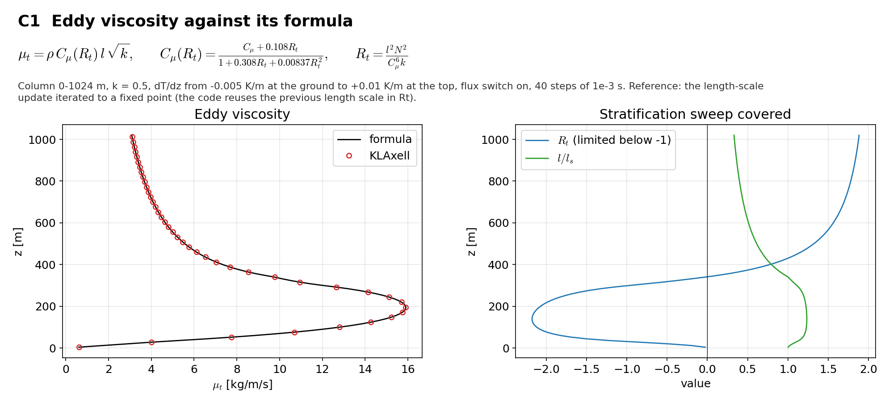

# C1 Eddy-viscosity field check

## Purpose
Compares `mu_turb` cell by cell with its formula over a sweep of stratification that covers the stable branch, the unstable branch and the limiter on $R_t$.

## Theory
$$\mu_t=\rho\,C_\mu(R_t)\,l\sqrt{k},\qquad R_t=\frac{l^2N^2}{C_\mu^6k}$$

Stable: $l=l_sl_b/\sqrt{l_s^2+l_b^2}$. Unstable: $l=l_s\sqrt{1-C_\mu^6C_{b,u}^{-2}R_t}$ with $R_t$ limited below $-1$ towards $-3$. The code evaluates $R_t$ with the length scale of the previous update, so the reference iterates the same update to a fixed point.

## Files
- `c1_field_check.inp`: input deck.
- `rans_1d.info`: 1-D profile file that `KransAxell` requires; not used by this case.
- `run.sh`: runs every variant in `runs/<variant>` and then `compare.py`.
- `compare.py`: reads the sampler output, evaluates the reference, writes `result.json` and `figure.png`.
- `result.json`, `figure.png`: results of the run reported below.
- Shared helper: `tools/klaxell_analytic.py`.

## Setup
Column 0-1024 m, 4 x 4 x 128 cells, k = 0.5 m2/s2, dT/dz from -0.005 K/m at the ground to +0.01 K/m at the top, flux switch on, 40 steps of 1e-3 s.

| Variant | Set by |
|---|---|
| `base` | the deck as written |

## Data and acknowledgements
No external data are used.

## How to run
```
./run.sh /path/to/kynema_sgf
```

## Expected Results
Status of the run reported here: **pass**.

| Check | Code | Reference | Error | Tolerance |
|---|---|---|---|---|
| largest difference in mu_turb, stable cells | 1.22615e-05 | 0 | 1.23e-05 | 0.001 |
| largest difference in mu_turb, unstable cells | 5.47205e-06 | 0 | 5.47e-06 | 0.001 |

Reported, not checked:

| Quantity | Code | Reference |
|---|---|---|
| Rt range in the column, min | -2.17784 | - |
| Rt range in the column, max | 1.87912 | - |
| change of the reference length scale in its last iteration | 0 | - |
| largest change of k from its initial value | 0.00309981 | - |

This check does not need time integration and is a candidate for a unit test in `unit_tests/turbulence/test_turbulence_RANS.cpp`.



## CTest
Not registered. The case runs through `run.sh`; `compare.py` prints PASS or FAIL and `../summarize.py` exits non-zero if any case fails.
