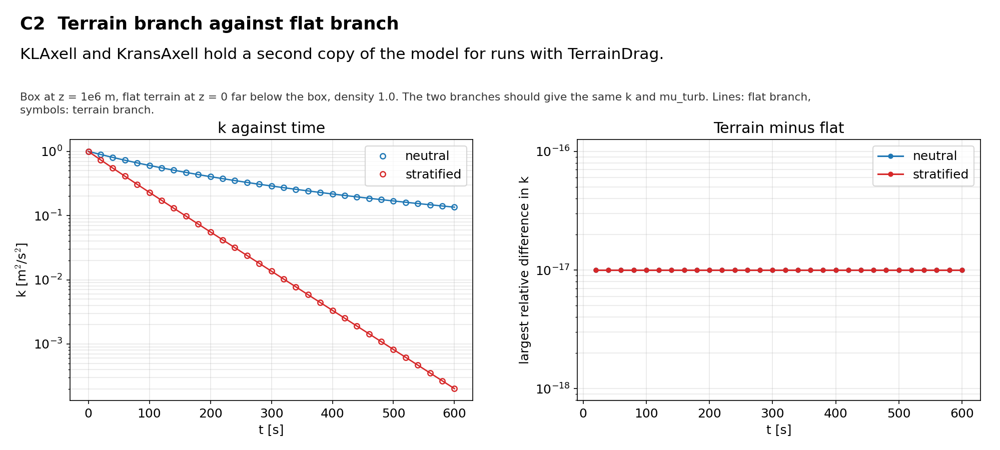

# C2 Terrain-branch parity

## Purpose
`KLAxell` and `KransAxell` hold a second copy of the model for runs with `TerrainDrag`. With a flat terrain far below the box the two copies must give the same answer.

## Theory
No closed form. The check is the difference between two runs.

## Files
- `c2_neutral.inp`: input deck.
- `c2_stratified.inp`: input deck.
- `terrain.amrwind`: flat terrain at z = 0.
- `rans_1d.info`: 1-D profile file that `KransAxell` requires; not used by this case.
- `run.sh`: runs every variant in `runs/<variant>` and then `compare.py`.
- `compare.py`: reads the sampler output, evaluates the reference, writes `result.json` and `figure.png`.
- `result.json`, `figure.png`: results of the run reported below.
- Shared helper: `tools/klaxell_analytic.py`.

## Setup
64 m box at z = 1e6 m, neutral decay and stably stratified decay (dT/dz = 0.01 K/m, flux switch on), each with `incflo.physics = ABL` and with `incflo.physics = ABL TerrainDrag` on a flat terrain at z = 0.

| Variant | Set by |
|---|---|
| `neutral_flat, neutral_terrain` | `c2_neutral.inp` |
| `stratified_flat, stratified_terrain` | `c2_stratified.inp` |

## Data and acknowledgements
No external data are used.

## How to run
```
./run.sh /path/to/kynema_sgf
```

## Expected Results
Status of the run reported here: **pass**.

| Check | Code | Reference | Error | Tolerance |
|---|---|---|---|---|
| neutral: largest relative difference in k | 0 | 0 | 0 | 1e-08 |
| neutral: largest relative difference in mu_turb | 0 | 0 | 0 | 1e-08 |
| stratified: largest relative difference in k | 0 | 0 | 0 | 1e-08 |
| stratified: largest relative difference in mu_turb | 0 | 0 | 0 | 1e-08 |

Reported, not checked:

| Quantity | Code | Reference |
|---|---|---|
| neutral: largest difference in U [m/s] | 0 | - |
| stratified: largest difference in U [m/s] | 0 | - |

The terrain is below the domain, so no cell is blanked or tagged for drag. The check covers the length-scale and source formulas of the terrain branch, not its wall treatment.



## CTest
Not registered. The case runs through `run.sh`; `compare.py` prints PASS or FAIL and `../summarize.py` exits non-zero if any case fails.
