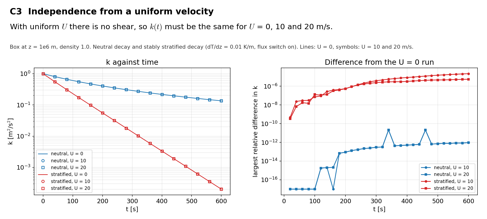

# C3 Independence from a uniform velocity

## Purpose
With a uniform velocity there is no shear, so k(t) must not depend on its value.

## Theory
No closed form. The check is the difference between runs at U = 0, 10 and 20 m/s.

## Files
- `c3_neutral.inp`: input deck.
- `c3_stratified.inp`: input deck.
- `rans_1d.info`: 1-D profile file that `KransAxell` requires; not used by this case.
- `run.sh`: runs every variant in `runs/<variant>` and then `compare.py`.
- `compare.py`: reads the sampler output, evaluates the reference, writes `result.json` and `figure.png`.
- `result.json`, `figure.png`: results of the run reported below.
- Shared helper: `tools/klaxell_analytic.py`.

## Setup
64 m box at z = 1e6 m, neutral decay and stably stratified decay (dT/dz = 0.01 K/m, flux switch on), 600 s.

| Variant | Set by |
|---|---|
| `neutral_u00, _u10, _u20` | `c3_neutral.inp` with `incflo.velocity` |
| `stratified_u00, _u10, _u20` | `c3_stratified.inp` with `incflo.velocity` |

## Data and acknowledgements
No external data are used.

## How to run
```
./run.sh /path/to/kynema_sgf
```

## Expected Results
Status of the run reported here: **pass**.

| Check | Code | Reference | Error | Tolerance |
|---|---|---|---|---|
| neutral: largest relative difference in k, U = 10 against U = 0 | 2.109e-11 | 0 | 2.11e-11 | 1e-08 |
| neutral: largest relative difference in k, U = 20 against U = 0 | 2.109e-11 | 0 | 2.11e-11 | 1e-08 |
| stratified: largest relative difference in k, U = 10 against U = 0 | 2.21922e-05 | 0 | 2.22e-05 | 0.0001 |
| stratified: largest relative difference in k, U = 20 against U = 0 | 5.6159e-06 | 0 | 5.62e-06 | 0.0001 |

The neutral runs agree to 2e-11. The stratified runs agree to 2e-5: the projection and temperature solves leave noise of 1e-7 in w and T, and it grows relative to k while k decays by four orders of magnitude. The tolerance for the stratified runs is 1e-4.



## CTest
Not registered. The case runs through `run.sh`; `compare.py` prints PASS or FAIL and `../summarize.py` exits non-zero if any case fails.
