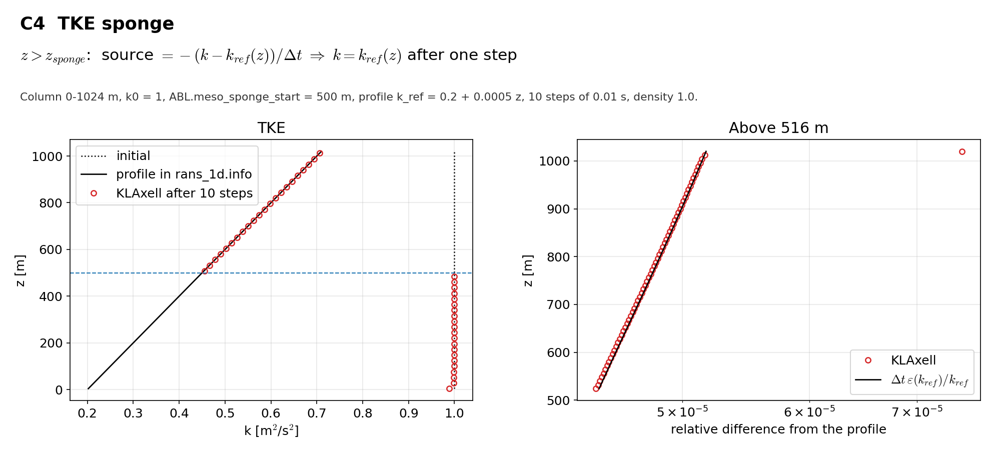

# C4 TKE sponge

## Purpose
Above `ABL.meso_sponge_start` the TKE source relaxes k to the profile in `rans_1d.info` within one step.

## Theory
$$z>z_{sponge}:\quad \mathrm{source}=-\frac{k-k_{ref}(z)}{\Delta t}\quad\Rightarrow\quad k=k_{ref}(z)-\Delta t\,\varepsilon(k_{ref})$$

The remaining offset is the dissipation of one step.

## Files
- `c4_tke_sponge.inp`: input deck.
- `rans_1d.info`: 1-D profile file that `KransAxell` requires (the sponge profile here).
- `run.sh`: runs every variant in `runs/<variant>` and then `compare.py`.
- `compare.py`: reads the sampler output, evaluates the reference, writes `result.json` and `figure.png`.
- `result.json`, `figure.png`: results of the run reported below.
- Shared helper: `tools/klaxell_analytic.py`.

## Setup
Column 0-1024 m, 4 x 4 x 128 cells, k0 = 1, `ABL.meso_sponge_start = 500`, profile k = 0.2 + 0.0005 z, 10 steps of 0.01 s.

| Variant | Set by |
|---|---|
| `base` | the deck as written |

## Data and acknowledgements
No external data are used.

## How to run
```
./run.sh /path/to/kynema_sgf
```

## Expected Results
Status of the run reported here: **pass**.

| Check | Code | Reference | Error | Tolerance |
|---|---|---|---|---|
| largest |k - profile| / profile above 516 m | 7.46867e-05 | 0 | 7.47e-05 | 0.001 |
| largest |k - k0| / k0 below 484 m | 0.00173614 | 0 | 0.00174 | 0.01 |

Reported, not checked:

| Quantity | Code | Reference |
|---|---|---|
| mean (profile - k) above 516 m, against dt * dissipation | 2.84964e-05 | 2.8302e-05 |
| k / profile - 1 in the first cell above the start height | 0.00433786 | - |

The first cell above the start height also receives diffusion from the unsponged cell below (0.4 % here) and is left out of the check.



## CTest
Not registered. The case runs through `run.sh`; `compare.py` prints PASS or FAIL and `../summarize.py` exits non-zero if any case fails.
