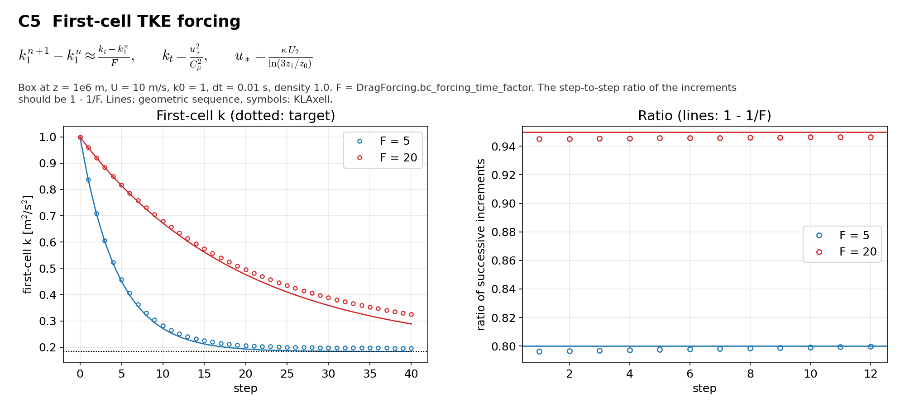

# C5 First-cell TKE forcing

## Purpose
The lowest cell is relaxed to $u_*^2/C_\mu^2$ on the time scale `DragForcing.bc_forcing_time_factor` x dt. The case checks the rate.

## Theory
$$k_1^{n+1}-k_1^{n}\approx\frac{k_t-k_1^{n}}{F},\qquad k_t=\frac{u_*^2}{C_\mu^2},\qquad u_*=\frac{\kappa U_2}{\ln(3z_1/z_0)}$$

$F$ is the time factor, $z_1$ the height of the first cell centre, $U_2$ the speed in the second cell. Successive increments shrink by $1-1/F$.

## Files
- `c5_wall_forcing.inp`: input deck.
- `rans_1d.info`: 1-D profile file that `KransAxell` requires; not used by this case.
- `run.sh`: runs every variant in `runs/<variant>` and then `compare.py`.
- `compare.py`: reads the sampler output, evaluates the reference, writes `result.json` and `figure.png`.
- `result.json`, `figure.png`: results of the run reported below.
- Shared helper: `tools/klaxell_analytic.py`.

## Setup
64 m box at z = 1e6 m, U = 10 m/s, k0 = 1, 40 steps of 0.01 s so that diffusion to the second cell and dissipation stay small within a step.

| Variant | Set by |
|---|---|
| `factor_05` | `DragForcing.bc_forcing_time_factor=5.0` |
| `factor_20` | `DragForcing.bc_forcing_time_factor=20.0` |

## Data and acknowledgements
No external data are used.

## How to run
```
./run.sh /path/to/kynema_sgf
```

## Expected Results
Status of the run reported here: **pass**.

| Check | Code | Reference | Error | Tolerance |
|---|---|---|---|---|
| F = 5: ratio of successive increments | 0.798041 | 0.8 | 0.245 % | 2 % |
| F = 20: ratio of successive increments | 0.945833 | 0.95 | 0.439 % | 2 % |

Reported, not checked:

| Quantity | Code | Reference |
|---|---|---|
| F = 5: first-cell k after 40 steps | 0.196584 | 0.18345 |
| F = 5: second-cell k after 40 steps | 0.903428 | - |
| F = 20: first-cell k after 40 steps | 0.325424 | 0.18345 |
| F = 20: second-cell k after 40 steps | 0.92901 | - |

With `fixed_dt = 0.25` the first cell is coupled to the second by diffusion and the ratio moves away from 1 - 1/F (0.908 against 0.95 for F = 20).



## CTest
Not registered. The case runs through `run.sh`; `compare.py` prints PASS or FAIL and `../summarize.py` exits non-zero if any case fails.
