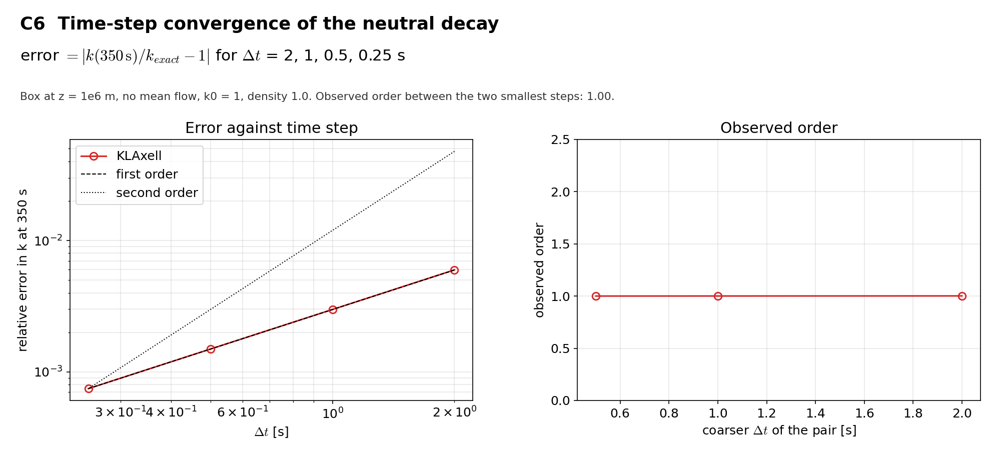

# C6 Time-step convergence

## Purpose
Measures the order of the time integration of the TKE source with the neutral decay.

## Theory
The error is $|k(350\,\mathrm{s})/k_{exact}-1|$ for four time steps; the order is the base-2 logarithm of the ratio of successive errors.

## Files
- `c6_timestep_convergence.inp`: input deck.
- `rans_1d.info`: 1-D profile file that `KransAxell` requires; not used by this case.
- `run.sh`: runs every variant in `runs/<variant>` and then `compare.py`.
- `compare.py`: reads the sampler output, evaluates the reference, writes `result.json` and `figure.png`.
- `result.json`, `figure.png`: results of the run reported below.
- Shared helper: `tools/klaxell_analytic.py`.

## Setup
64 m box at z = 1e6 m, no mean flow, k0 = 1, dt = 2, 1, 0.5, 0.25 s.

| Variant | Set by |
|---|---|
| `dt_2000 ... dt_0250` | `time.fixed_dt` and the matching `sampling.output_interval` |

## Data and acknowledgements
No external data are used.

## How to run
```
./run.sh /path/to/kynema_sgf
```

## Expected Results
Status of the run reported here: **pass**.

| Check | Code | Reference | Error | Tolerance |
|---|---|---|---|---|
| observed order, dt = 0.5 to 0.25 s | 1.00046 | 1 | 0.000465 | 0.15 |

Reported, not checked:

| Quantity | Code | Reference |
|---|---|---|
| relative error at t = 350 s, dt = 2 s | 0.00597628 | - |
| relative error at t = 350 s, dt = 1 s | 0.00298428 | - |
| relative error at t = 350 s, dt = 0.5 s | 0.00149118 | - |
| relative error at t = 350 s, dt = 0.25 s | 0.00074535 | - |
| observed order, dt = 2 to 1 s | 1.00186 | - |
| observed order, dt = 1 to 0.5 s | 1.00093 | - |
| observed order, dt = 0.5 to 0.25 s | 1.00046 | - |

The observed order is 1.00. The check pins first order; a change of the source integration would show here.



## CTest
Not registered. The case runs through `run.sh`; `compare.py` prints PASS or FAIL and `../summarize.py` exits non-zero if any case fails.
