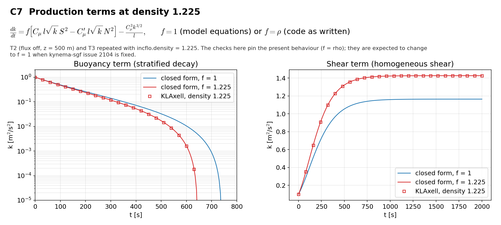

# C7 Density weighting of the production terms

## Purpose
Documents kynema-sgf issue 2104: the shear and buoyancy terms are weighted by density relative to dissipation. T2 (flux off) and T3 are repeated at `incflo.density = 1.225`.

## Theory
$$\frac{dk}{dt}=f\left[C_\mu\,l\sqrt{k}\,S^2-C_\mu^\prime\,l\sqrt{k}\,N^2\right]-\frac{C_\mu^3k^{3/2}}{l}$$

$f=1$ in the model equations and $f=\rho$ in the code as written. The closed forms of T2 and T3 hold with $N^2\to fN^2$ and $S^2\to fS^2$.

## Files
- `c7_shear.inp`: input deck.
- `c7_stratified.inp`: input deck.
- `rans_1d.info`: 1-D profile file that `KransAxell` requires; not used by this case.
- `run.sh`: runs every variant in `runs/<variant>` and then `compare.py`.
- `compare.py`: reads the sampler output, evaluates the reference, writes `result.json` and `figure.png`.
- `result.json`, `figure.png`: results of the run reported below.
- Shared helper: `tools/klaxell_analytic.py`.

## Setup
The decks of T2 (1000 s) and T3 with `incflo.density=1.225`; the no-slip walls of the shear deck also need `zlo.density` and `zhi.density`.

| Variant | Set by |
|---|---|
| `stratified_rho1225` | `c7_stratified.inp` |
| `shear_rho1225` | `c7_shear.inp` |

## Data and acknowledgements
No external data are used.

## How to run
```
./run.sh /path/to/kynema_sgf
```

## Expected Results
Status of the run reported here: **pass**.

| Check | Code | Reference | Error | Tolerance |
|---|---|---|---|---|
| buoyancy: k at t = 100 s against f = rho | 0.468272 | 0.468814 | 0.116 % | 1 % |
| buoyancy: k at t = 300 s against f = rho | 0.117004 | 0.117364 | 0.307 % | 1 % |
| buoyancy: k at t = 500 s against f = rho | 0.0168535 | 0.0169604 | 0.63 % | 1 % |
| buoyancy: time of k = 0 against f = rho [s] | 645 | 645.909 | 0.141 % | 1 % |
| shear: k at t = 400 s against f = rho | 1.227 | 1.2269 | 0.00827 % | 0.3 % |
| shear: k at t = 1000 s against f = rho | 1.42283 | 1.42281 | 0.000975 % | 0.3 % |
| shear: k at t = 2000 s against f = rho | 1.42634 | 1.42634 | 2.58e-06 % | 0.3 % |

Reported, not checked:

| Quantity | Code | Reference |
|---|---|---|
| buoyancy: k at t = 100 s against f = 1 | 0.468272 | 0.486202 |
| buoyancy: k at t = 300 s against f = 1 | 0.117004 | 0.139403 |
| buoyancy: k at t = 500 s against f = 1 | 0.0168535 | 0.0325204 |
| buoyancy: time of k = 0 for f = 1 [s] | 741.092 | - |
| shear: k at t = 400 s against f = 1 | 1.227 | 0.968157 |
| shear: k at t = 1000 s against f = 1 | 1.42283 | 1.15912 |
| shear: k at t = 2000 s against f = 1 | 1.42634 | 1.16435 |
| shear: k_eq for f = rho | 1.42635 | 1.16437 |

The checks pin the present behaviour (f = rho). They are expected to fail, and should then be changed to f = 1, when issue 2104 is fixed. The same runs against f = 1 are listed as reported values.



## CTest
Not registered. The case runs through `run.sh`; `compare.py` prints PASS or FAIL and `../summarize.py` exits non-zero if any case fails.
