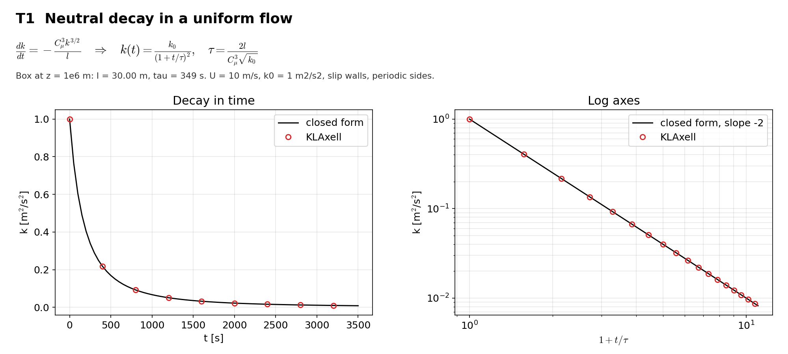

# T1 Neutral decay

## Purpose
Uniform velocity and uniform temperature leave only dissipation in the TKE equation. The case checks the dissipation term and its time integration against a closed form.

## Theory
$$\frac{dk}{dt}=-\frac{C_\mu^3 k^{3/2}}{l}\quad\Rightarrow\quad k(t)=\frac{k_0}{(1+t/\tau)^2},\qquad \tau=\frac{2l}{C_\mu^3\sqrt{k_0}}$$

$k$ is the TKE, $k_0$ its initial value, $l$ the length scale, $C_\mu = 0.556$. The neutral length scale is $l_s=\lambda\kappa z/(\lambda+\kappa z)$ with $z$ the absolute height. The box sits at $z = 10^6$ m, where $l_s = 29.998$ m is uniform to 1e-8.

## Files
- `t1_neutral_decay.inp`: input deck.
- `rans_1d.info`: 1-D profile file that `KransAxell` requires; not used by this case.
- `run.sh`: runs every variant in `runs/<variant>` and then `compare.py`.
- `compare.py`: reads the sampler output, evaluates the reference, writes `result.json` and `figure.png`.
- `result.json`, `figure.png`: results of the run reported below.
- Shared helper: `tools/klaxell_analytic.py`.

## Setup
64 m box, 8 x 8 x 8 cells, periodic sides, slip walls, U = 10 m/s, k0 = 1 m2/s2, `fixed_dt = 0.25`, 3500 s.

| Variant | Set by |
|---|---|
| `base` | the deck as written |

## Data and acknowledgements
No external data are used.

## How to run
```
./run.sh /path/to/kynema_sgf
```

## Expected Results
Status of the run reported here: **pass**.

| Check | Code | Reference | Error | Tolerance |
|---|---|---|---|---|
| k at t = 50 s | 0.764915 | 0.765108 | 0.0252 % | 0.2 % |
| k at t = 350 s | 0.249139 | 0.249325 | 0.0745 % | 0.2 % |
| k at t = 1000 s | 0.0668965 | 0.0669469 | 0.0752 % | 0.2 % |
| k at t = 3500 s | 0.00822013 | 0.00822397 | 0.0468 % | 0.2 % |
| log slope against (1 + t/tau) | -1.99971 | -2 | 0.0143 % | 0.5 % |

Reported, not checked:

| Quantity | Code | Reference |
|---|---|---|
| length scale l [m] | 29.9978 | - |
| tau [s] | 349.056 | - |
| largest spread of k over the box | 7.23113e-09 | - |



## CTest
Not registered. The case runs through `run.sh`; `compare.py` prints PASS or FAIL and `../summarize.py` exits non-zero if any case fails.
