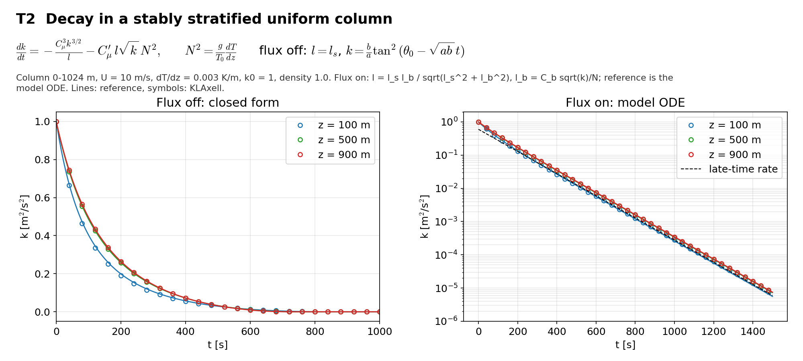

# T2 Stratified decay

## Purpose
Uniform velocity with a constant stable temperature gradient. The case checks the buoyancy sink and, with the flux switch on, the stable length scale and the heat stability function.

## Theory
$$\frac{dk}{dt}=-\frac{C_\mu^3 k^{3/2}}{l}-C_\mu^\prime(R_t)\,l\sqrt{k}\,N^2,\qquad N^2=\frac{g}{T_0}\frac{dT}{dz}$$

**Flux off** (`ABL.surface_temp_flux = 0`): the model keeps $l=l_s$ and $R_t=0$, so $C_\mu^\prime=C_\mu$ and

$$k(t)=\frac{b}{a}\tan^2\left(\theta_0-\sqrt{ab}\,t\right),\qquad a=\frac{C_\mu^3}{2l},\quad b=\frac{C_\mu l N^2}{2},\quad \theta_0=\tan^{-1}\sqrt{k_0a/b}$$

$k$ reaches zero at $t^*=\theta_0/\sqrt{ab}$.

**Flux on** (`ABL.surface_temp_flux = 1e-4`): $l=l_sl_b/\sqrt{l_s^2+l_b^2}$, $l_b=C_b\sqrt{k}/N$, $R_t=l^2N^2/(C_\mu^6k)$, $C_\mu^\prime=C_\mu/(1+0.277R_t)$. The reference is this ODE integrated with RK4. For $l_b\ll l_s$ the decay is exponential with rate $N[C_\mu^3/C_b+C_\mu^\prime(R_{t\infty})C_b]$, $R_{t\infty}=C_b^2/C_\mu^6$.

## Files
- `t2_stratified_decay.inp`: input deck.
- `rans_1d.info`: 1-D profile file that `KransAxell` requires; not used by this case.
- `run.sh`: runs every variant in `runs/<variant>` and then `compare.py`.
- `compare.py`: reads the sampler output, evaluates the reference, writes `result.json` and `figure.png`.
- `result.json`, `figure.png`: results of the run reported below.
- Shared helper: `tools/klaxell_analytic.py`.

## Setup
Column 32 x 32 x 1024 m on the ground, 4 x 4 x 128 cells, periodic sides, slip walls, U = 10 m/s, dT/dz = 0.003 K/m, k0 = 1 m2/s2, `fixed_dt = 0.25`, 1500 s. With slip walls the flux value only selects the length-scale branch; no heat flux is applied.

| Variant | Set by |
|---|---|
| `flux_off` | `ABL.surface_temp_flux=0.0` |
| `flux_on` | `ABL.surface_temp_flux=1.0e-4` |

## Data and acknowledgements
No external data are used.

## How to run
```
./run.sh /path/to/kynema_sgf
```

## Expected Results
Status of the run reported here: **pass**.

| Check | Code | Reference | Error | Tolerance |
|---|---|---|---|---|
| flux off, z = 500 m, t = 100 s | 0.485649 | 0.486202 | 0.114 % | 1 % |
| flux off, z = 500 m, t = 300 s | 0.13898 | 0.139403 | 0.304 % | 1 % |
| flux off, z = 500 m, t = 500 s | 0.032357 | 0.0325204 | 0.502 % | 1 % |
| flux off, z = 500 m, time of k = 0 [s] | 740 | 741.092 | 0.147 % | 1 % |
| flux off, z = 900 m, t = 100 s | 0.495172 | 0.495564 | 0.0791 % | 1 % |
| flux off, z = 900 m, t = 300 s | 0.142335 | 0.142633 | 0.209 % | 1 % |
| flux off, z = 900 m, t = 500 s | 0.0316663 | 0.0318069 | 0.442 % | 1 % |
| flux off, z = 900 m, time of k = 0 [s] | 725 | 726.208 | 0.166 % | 1 % |
| flux on, z = 500 m, t = 100 s | 0.390509 | 0.391023 | 0.132 % | 1.5 % |
| flux on, z = 500 m, t = 300 s | 0.0752178 | 0.0754389 | 0.293 % | 1.5 % |
| flux on, z = 500 m, t = 500 s | 0.0158096 | 0.0158747 | 0.41 % | 1.5 % |
| flux on, z = 500 m, t = 800 s | 0.00156837 | 0.0015774 | 0.573 % | 1.5 % |
| flux on, z = 900 m, t = 100 s | 0.396814 | 0.39727 | 0.115 % | 1.5 % |
| flux on, z = 900 m, t = 300 s | 0.0771787 | 0.0773858 | 0.268 % | 1.5 % |
| flux on, z = 900 m, t = 500 s | 0.0162514 | 0.0163166 | 0.399 % | 1.5 % |
| flux on, z = 900 m, t = 800 s | 0.00161246 | 0.00162209 | 0.593 % | 1.5 % |
| flux on, decay rate 500-900 s [1/s] | 0.00769805 | 0.0076776 | 0.266 % | 2 % |

Reported, not checked:

| Quantity | Code | Reference |
|---|---|---|
| flux off, z = 100 m, t = 300 s (diffusion acts here) | 0.101931 | 0.106015 |
| flux on, z = 100 m, t = 300 s (diffusion acts here) | 0.0581698 | 0.0592417 |

The references are zero-dimensional. At z = 100 m the length scale varies with height and k diffuses vertically; those rows are reported but not used as pass criteria.



## CTest
Not registered. The case runs through `run.sh`; `compare.py` prints PASS or FAIL and `../summarize.py` exits non-zero if any case fails.
