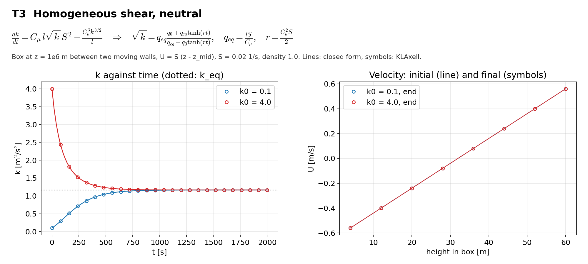

# T3 Homogeneous shear

## Purpose
A uniform shear with a uniform length scale. The case checks the shear production term against a closed form.

## Theory
$$\frac{dk}{dt}=C_\mu\,l\sqrt{k}\,S^2-\frac{C_\mu^3k^{3/2}}{l}\quad\Rightarrow\quad\sqrt{k}=q_{eq}\frac{q_0+q_{eq}\tanh(rt)}{q_{eq}+q_0\tanh(rt)},\qquad q_{eq}=\frac{lS}{C_\mu},\quad r=\frac{C_\mu^2S}{2}$$

$S$ is the shear $dU/dz$, $q_0=\sqrt{k_0}$. The equilibrium is $k_{eq}=l^2S^2/C_\mu^2$.

## Files
- `t3_homogeneous_shear.inp`: input deck.
- `rans_1d.info`: 1-D profile file that `KransAxell` requires; not used by this case.
- `run.sh`: runs every variant in `runs/<variant>` and then `compare.py`.
- `compare.py`: reads the sampler output, evaluates the reference, writes `result.json` and `figure.png`.
- `result.json`, `figure.png`: results of the run reported below.
- Shared helper: `tools/klaxell_analytic.py`.

## Setup
64 m box at z = 1e6 m, 8 x 8 x 8 cells, periodic sides, two no-slip walls moving at -0.64 and +0.64 m/s, U = S (z - z_mid) with S = 0.02 1/s, `fixed_dt = 0.25`, 2000 s. `ABL.linear_profile` uses the absolute height, so `ABL.bottom_velocity` and `ABL.top_velocity` carry the offset S z_mid.

| Variant | Set by |
|---|---|
| `k0_low` | `ABL.init_tke=0.1` (below equilibrium) |
| `k0_high` | `ABL.init_tke=4.0` (above equilibrium) |

## Data and acknowledgements
No external data are used.

## How to run
```
./run.sh /path/to/kynema_sgf
```

## Expected Results
Status of the run reported here: **pass**.

| Check | Code | Reference | Error | Tolerance |
|---|---|---|---|---|
| k0 = 0.1, t = 100 s | 0.345548 | 0.345671 | 0.0357 % | 0.3 % |
| k0 = 0.1, t = 400 s | 0.968234 | 0.968157 | 0.00794 % | 0.3 % |
| k0 = 0.1, t = 1000 s | 1.15914 | 1.15912 | 0.00143 % | 0.3 % |
| k0 = 0.1, t = 2000 s | 1.16435 | 1.16435 | 7.38e-06 % | 0.3 % |
| k0 = 4.0, t = 100 s | 2.22978 | 2.23123 | 0.065 % | 0.3 % |
| k0 = 4.0, t = 400 s | 1.28762 | 1.28799 | 0.0289 % | 0.3 % |
| k0 = 4.0, t = 1000 s | 1.16723 | 1.16725 | 0.00143 % | 0.3 % |
| k0 = 4.0, t = 2000 s | 1.16437 | 1.16437 | 5.38e-06 % | 0.3 % |

Reported, not checked:

| Quantity | Code | Reference |
|---|---|---|
| k0 = 0.1: shear at end, mid box [1/s] | 0.02 | 0.02 |
| k0 = 0.1: spread of k over the box at end | 1.93697e-09 | - |
| k0 = 4.0: shear at end, mid box [1/s] | 0.02 | 0.02 |
| k0 = 4.0: spread of k over the box at end | 1.85986e-09 | - |
| k_eq [m2/s2] | 1.16437 | - |



## CTest
Not registered. The case runs through `run.sh`; `compare.py` prints PASS or FAIL and `../summarize.py` exits non-zero if any case fails.
