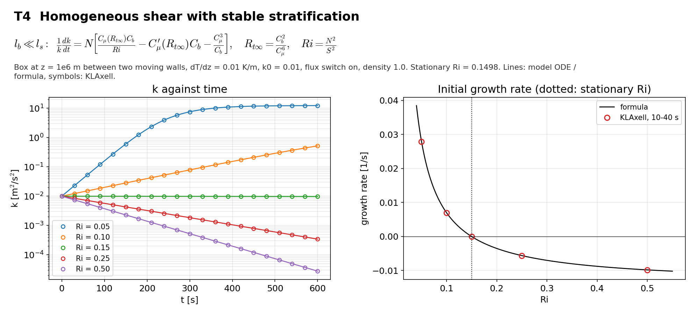

# T4 Stratified homogeneous shear

## Purpose
Uniform shear and uniform stable stratification. The case checks the two stability functions and the stable length scale together, through the growth rate of k as a function of the gradient Richardson number.

## Theory
For $l_b\ll l_s$ every term is linear in $k$:

$$\frac{1}{k}\frac{dk}{dt}=N\left[\frac{C_\mu(R_{t\infty})C_b}{Ri}-C_\mu^\prime(R_{t\infty})C_b-\frac{C_\mu^3}{C_b}\right],\qquad Ri=\frac{N^2}{S^2},\qquad R_{t\infty}=\frac{C_b^2}{C_\mu^6}$$

$C_\mu(R_t)=(C_\mu+0.108R_t)/(1+0.308R_t+0.00837R_t^2)$ and $C_\mu^\prime(R_t)=C_\mu/(1+0.277R_t)$. The rate is zero at the stationary Richardson number 0.1498. The full reference is the model ODE integrated with RK4.

## Files
- `t4_stratified_shear.inp`: input deck.
- `rans_1d.info`: 1-D profile file that `KransAxell` requires; not used by this case.
- `run.sh`: runs every variant in `runs/<variant>` and then `compare.py`.
- `compare.py`: reads the sampler output, evaluates the reference, writes `result.json` and `figure.png`.
- `result.json`, `figure.png`: results of the run reported below.
- Shared helper: `tools/klaxell_analytic.py`.

## Setup
64 m box at z = 1e6 m, 8 x 8 x 8 cells, two moving no-slip walls, dT/dz = 0.01 K/m, k0 = 0.01 m2/s2, flux switch on, `fixed_dt = 0.1`, 600 s.

| Variant | Set by |
|---|---|
| `ri_005 ... ri_050` | wall and initial velocities for Ri = 0.05, 0.10, 0.15, 0.25, 0.50 |

## Data and acknowledgements
No external data are used.

## How to run
```
./run.sh /path/to/kynema_sgf
```

## Expected Results
Status of the run reported here: **pass**.

| Check | Code | Reference | Error | Tolerance |
|---|---|---|---|---|
| Ri = 0.05, k at t = 100 s | 0.159748 | 0.160124 | 0.235 % | 2 % |
| Ri = 0.05, k at t = 300 s | 7.58371 | 7.59257 | 0.117 % | 2 % |
| Ri = 0.05, k at t = 600 s | 12.3475 | 12.3474 | 0.000425 % | 2 % |
| Ri = 0.05, growth rate 10-40 s [1/s] | 0.0278592 | 0.0279762 | 0.000117 | 0.0003 |
| Ri = 0.10, k at t = 100 s | 0.0200111 | 0.0200127 | 0.00785 % | 2 % |
| Ri = 0.10, k at t = 300 s | 0.0788306 | 0.078848 | 0.022 % | 2 % |
| Ri = 0.10, k at t = 600 s | 0.521965 | 0.522118 | 0.0294 % | 2 % |
| Ri = 0.10, growth rate 10-40 s [1/s] | 0.00694427 | 0.00697942 | 3.52e-05 | 0.0003 |
| Ri = 0.15, k at t = 100 s | 0.00995717 | 0.00995717 | 4.94e-05 % | 2 % |
| Ri = 0.15, k at t = 300 s | 0.00987236 | 0.00987236 | 5.63e-05 % | 2 % |
| Ri = 0.15, k at t = 600 s | 0.00974722 | 0.00974723 | 7.15e-05 % | 2 % |
| Ri = 0.15, growth rate 10-40 s [1/s] | -4.29499e-05 | -1.94889e-05 | 2.35e-05 | 0.0003 |
| Ri = 0.25, k at t = 100 s | 0.00569201 | 0.0056931 | 0.0192 % | 2 % |
| Ri = 0.25, k at t = 300 s | 0.00184716 | 0.00184821 | 0.0573 % | 2 % |
| Ri = 0.25, k at t = 600 s | 0.000341972 | 0.000342364 | 0.114 % | 2 % |
| Ri = 0.25, growth rate 10-40 s [1/s] | -0.00563723 | -0.00561862 | 1.86e-05 | 0.0003 |
| Ri = 0.50, k at t = 100 s | 0.00374076 | 0.00374256 | 0.0483 % | 2 % |
| Ri = 0.50, k at t = 300 s | 0.000524246 | 0.000525006 | 0.145 % | 2 % |
| Ri = 0.50, k at t = 600 s | 2.75236e-05 | 2.76034e-05 | 0.289 % | 2 % |
| Ri = 0.50, growth rate 10-40 s [1/s] | -0.00983534 | -0.00981797 | 1.74e-05 | 0.0003 |

Reported, not checked:

| Quantity | Code | Reference |
|---|---|---|
| stationary Richardson number | 0.149791 | - |
| Rt in the limit l_b << l_s | 2.11559 | - |



## CTest
Not registered. The case runs through `run.sh`; `compare.py` prints PASS or FAIL and `../summarize.py` exits non-zero if any case fails.
