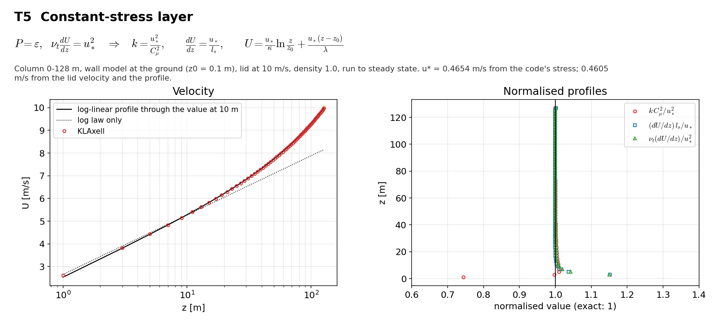

# T5 Constant-stress layer

## Purpose
A steady layer with constant shear stress between a rough ground and a moving lid. Production balances dissipation at every height with the real length scale $l_s(z)$. The case checks the equilibrium TKE level and the velocity profile.

## Theory
$$\nu_t\frac{dU}{dz}=u_*^2,\quad P=\varepsilon\quad\Rightarrow\quad k=\frac{u_*^2}{C_\mu^2},\qquad\frac{dU}{dz}=\frac{u_*}{l_s},\qquad U(z)=\frac{u_*}{\kappa}\ln\frac{z}{z_0}+\frac{u_*(z-z_0)}{\lambda}$$

$u_*$ is the friction velocity, $z_0$ the roughness length. The profile is the log law plus a linear term from the blended length scale.

## Files
- `t5_constant_stress.inp`: input deck.
- `rans_1d.info`: 1-D profile file that `KransAxell` requires; not used by this case.
- `run.sh`: runs every variant in `runs/<variant>` and then `compare.py`.
- `compare.py`: reads the sampler output, evaluates the reference, writes `result.json` and `figure.png`.
- `result.json`, `figure.png`: results of the run reported below.
- Shared helper: `tools/klaxell_analytic.py`.

## Setup
Column 128 x 128 x 128 m, 4 x 4 x 64 cells (dz = 2 m), wall model at the ground with z0 = 0.1 m, no-slip lid at 10 m/s, first-cell TKE forcing active (time factor 5), `fixed_dt = 1`, 40000 s to steady state.

| Variant | Set by |
|---|---|
| `base` | the deck as written |

## Data and acknowledgements
No external data are used.

## How to run
```
./run.sh /path/to/kynema_sgf
```

## Expected Results
Status of the run reported here: **pass**.

| Check | Code | Reference | Error | Tolerance |
|---|---|---|---|---|
| k Cmu^2 / u*^2, mean over 10-100 m | 1.0008 | 1 | 0.0799 % | 0.5 % |
| (dU/dz) l_s / u*, mean over 10-100 m | 0.999601 | 1 | 0.0399 % | 0.5 % |
| u* against the value set by the lid [m/s] | 0.465443 | 0.460541 | 1.06 % | 2 % |
| largest profile difference over 10-100 m / U_lid | 0.000889333 | 0 | 0.000889 | 0.003 |

Reported, not checked:

| Quantity | Code | Reference |
|---|---|---|
| stress spread over 10-100 m (std / mean) | 0.00160286 | - |
| change of u* over the last output interval | 1.13132e-13 | - |
| first-cell k Cmu^2 / u*^2 | 0.743425 | 1 |
| k range over 10-100 m, min | 0.700333 | - |
| k range over 10-100 m, max | 0.706037 | - |

$u_*$ is taken from the code's own stress, $\nu_t\,dU/dz$ averaged over 10-100 m. The first-cell k is 0.74 of the interior value; it is reported, not checked.



## CTest
Not registered. The case runs through `run.sh`; `compare.py` prints PASS or FAIL and `../summarize.py` exits non-zero if any case fails.
