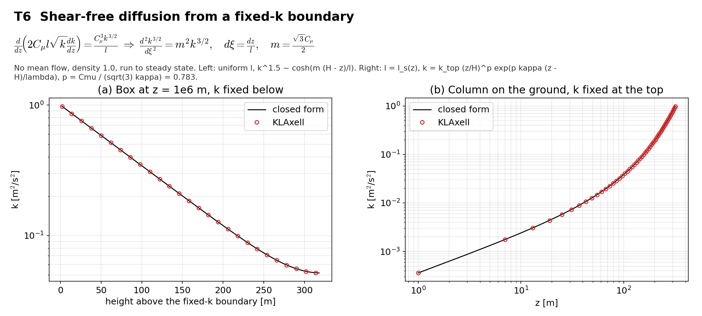

# T6 Shear-free diffusion

## Purpose
No mean flow and no stratification: TKE held at a boundary diffuses into the domain and is dissipated. The steady profile checks the TKE diffusivity $2\nu_t$.

## Theory
$$\frac{d}{dz}\left(2C_\mu l\sqrt{k}\frac{dk}{dz}\right)=\frac{C_\mu^3k^{3/2}}{l}\quad\Rightarrow\quad\frac{d^2k^{3/2}}{d\xi^2}=m^2k^{3/2},\qquad d\xi=\frac{dz}{l},\qquad m=\frac{\sqrt{3}\,C_\mu}{2}$$

**(a) Uniform $l$**, k fixed at the lower face and zero gradient at height $H$: $k=k_b\left[\cosh(m(H-z)/l)/\cosh(mH/l)\right]^{2/3}$.

**(b) $l=l_s(z)$**, k fixed at the top and zero flux at the ground: $\xi=\ln z/\kappa+z/\lambda$ and $k=k_{top}(z/H)^p\exp(p\kappa(z-H)/\lambda)$ with $p=C_\mu/(\sqrt{3}\kappa)=0.783$.

## Files
- `t6_elevated.inp`: input deck.
- `t6_ground.inp`: input deck.
- `rans_1d.info`: 1-D profile file that `KransAxell` requires; not used by this case.
- `run.sh`: runs every variant in `runs/<variant>` and then `compare.py`.
- `compare.py`: reads the sampler output, evaluates the reference, writes `result.json` and `figure.png`.
- `result.json`, `figure.png`: results of the run reported below.
- Shared helper: `tools/klaxell_analytic.py`.

## Setup
(a) 128 x 128 x 320 m box at z = 1e6 m, 4 x 4 x 80 cells. (b) the same size on the ground, 4 x 4 x 160 cells. No mean flow, k = 1 at the fixed boundary (`tke_type = no_slip_wall`), k0 = 0.1, `fixed_dt = 2`, 40000 s to steady state.

| Variant | Set by |
|---|---|
| `elevated` | `t6_elevated.inp` |
| `ground` | `t6_ground.inp` |

## Data and acknowledgements
No external data are used.

## How to run
```
./run.sh /path/to/kynema_sgf
```

## Expected Results
Status of the run reported here: **pass**.

| Check | Code | Reference | Error | Tolerance |
|---|---|---|---|---|
| elevated, k at 50 m above the boundary | 0.585472 | 0.585693 | 0.0378 % | 2 % |
| elevated, k at 100 m above the boundary | 0.350468 | 0.350573 | 0.03 % | 2 % |
| elevated, k at 200 m above the boundary | 0.121747 | 0.121763 | 0.013 % | 2 % |
| elevated, k at 300 m above the boundary | 0.053855 | 0.053852 | 0.00565 % | 2 % |
| ground, k at z = 20 m | 0.0043753 | 0.00437562 | 0.00734 % | 3 % |
| ground, k at z = 50 m | 0.0126657 | 0.0126645 | 0.00999 % | 3 % |
| ground, k at z = 100 m | 0.0375053 | 0.0375043 | 0.0027 % | 3 % |
| ground, k at z = 200 m | 0.188866 | 0.188881 | 0.00821 % | 3 % |
| ground, k at z = 300 m | 0.757288 | 0.757411 | 0.0162 % | 3 % |

Reported, not checked:

| Quantity | Code | Reference |
|---|---|---|
| elevated, largest change over the last output interval | 0 | - |
| elevated, e-folding length of k far from the top [m] | 93.4491 | - |
| ground, largest change over the last output interval | 0 | - |
| ground, exponent of the power law near the ground | 0.782943 | - |



## CTest
Not registered. The case runs through `run.sh`; `compare.py` prints PASS or FAIL and `../summarize.py` exits non-zero if any case fails.
