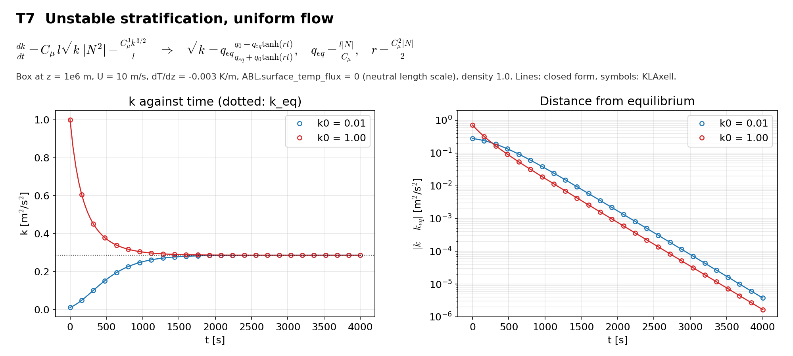

# T7 Unstable column

## Purpose
Uniform velocity with a constant unstable temperature gradient and the flux switch off. Buoyancy is a source; the case checks its sign and size.

## Theory
$$\frac{dk}{dt}=C_\mu\,l\sqrt{k}\,|N^2|-\frac{C_\mu^3k^{3/2}}{l}$$

This is the equation of T3 with $S^2$ replaced by $|N^2|$, so the same closed form applies with $q_{eq}=l|N|/C_\mu$ and $r=C_\mu^2|N|/2$.

## Files
- `t7_unstable_column.inp`: input deck.
- `rans_1d.info`: 1-D profile file that `KransAxell` requires; not used by this case.
- `run.sh`: runs every variant in `runs/<variant>` and then `compare.py`.
- `compare.py`: reads the sampler output, evaluates the reference, writes `result.json` and `figure.png`.
- `result.json`, `figure.png`: results of the run reported below.
- Shared helper: `tools/klaxell_analytic.py`.

## Setup
64 m box at z = 1e6 m, 8 x 8 x 8 cells, slip walls, U = 10 m/s, dT/dz = -0.003 K/m, `ABL.surface_temp_flux = 0`, `fixed_dt = 0.25`, 4000 s.

| Variant | Set by |
|---|---|
| `k0_low` | `ABL.init_tke=0.01` |
| `k0_high` | `ABL.init_tke=1.0` |

## Data and acknowledgements
No external data are used.

## How to run
```
./run.sh /path/to/kynema_sgf
```

## Expected Results
Status of the run reported here: **pass**.

| Check | Code | Reference | Error | Tolerance |
|---|---|---|---|---|
| k0 = 0.01, t = 200 s | 0.0600325 | 0.06006 | 0.0459 % | 0.5 % |
| k0 = 0.01, t = 1000 s | 0.2512 | 0.251194 | 0.00228 % | 0.5 % |
| k0 = 0.01, t = 4000 s | 0.285557 | 0.285557 | 3.2e-06 % | 0.5 % |
| k0 = 1.00, t = 200 s | 0.554538 | 0.554721 | 0.0329 % | 0.5 % |
| k0 = 1.00, t = 1000 s | 0.302225 | 0.302254 | 0.00947 % | 0.5 % |
| k0 = 1.00, t = 4000 s | 0.285562 | 0.285562 | 2.95e-06 % | 0.5 % |

Reported, not checked:

| Quantity | Code | Reference |
|---|---|---|
| k0 = 0.01: dT/dz at end, mid box [K/m] | -0.003 | -0.003 |
| k0 = 0.01: largest |w| at end [m/s] | 1.79948e-09 | - |
| k0 = 1.00: dT/dz at end, mid box [K/m] | -0.003 | -0.003 |
| k0 = 1.00: largest |w| at end [m/s] | 1.33939e-09 | - |
| k_eq [m2/s2] | 0.285561 | - |

The run stays one-dimensional: the largest vertical velocity is below 1e-8 m/s.



## CTest
Not registered. The case runs through `run.sh`; `compare.py` prints PASS or FAIL and `../summarize.py` exits non-zero if any case fails.
